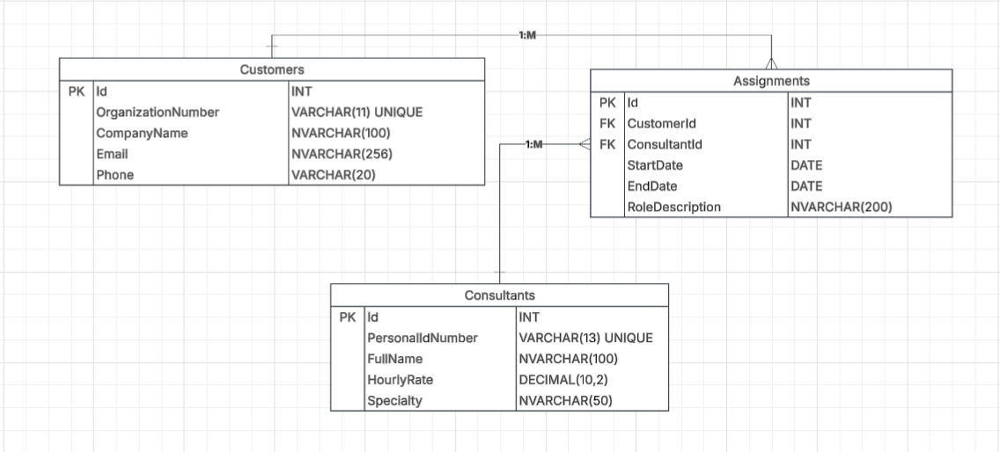

# FailSafe IT

Inlämningsuppgift 1, Databashantering SQL.

## ER-diagram

## Normalisering

- **1NF:** Ett värde per kolumn och en primärnyckel (Id) i varje tabell.
- **2NF:** Alla tabeller har en enkel primärnyckel, så inget beror på bara en del av nyckeln.
- **3NF:** Varje tabell beskriver bara sig själv. Kund- och konsultuppgifter finns bara i sina egna tabeller, och Assignments har bara id:n.

## DevSecOps

- **Sec:** Parametriserade frågor (SqlParameter), så att inmatning behandlas som data och inte som SQL. Applikationens databasanvändare får minsta möjliga behörighet.
- **Ops:** UNIQUE på OrganizationNumber skapar ett index, så sökningen blir en Index Seek i stället för en Table Scan.

  
## Designval

- **Databastyp:** En relationsdatabas passar bättre än Excel-filerna eftersom varje uppgift lagras en gång och främmande nycklar hindrar felaktiga kopplingar mellan kunder och konsulter.
- **Prestanda, skalbarhet och underhåll:** Index på OrganizationNumber ger snabba sökningar, tabellerna kan växa till många rader utan att designen ändras, och varje uppgift finns på ett ställe så den bara behöver ändras där.

## Köra skriptet

Anslut till `(localdb)\mssqllocaldb` i SSMS, öppna `FailSafeIT.sql` och tryck F5.
